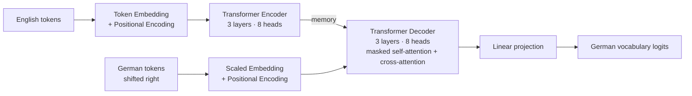

# Neural Machine Translation with a Transformer Encoder-Decoder


This project builds a sequence-to-sequence Transformer for English-to-German translation in PyTorch. It covers every stage of a translation system: preparing the data, building the vocabularies, designing the model, training it, and generating translations one token at a time.

---

## Table of Contents

- [Highlights](#highlights)
- [Architecture](#architecture)
- [Results](#results)
- [Getting Started](#getting-started)
- [Project Structure](#project-structure)
- [Pipeline Overview](#pipeline-overview)
- [Future Work](#future-work)
- [Acknowledgements](#acknowledgements)

---

## Highlights

- **Full encoder-decoder Transformer**: separate encoder and decoder stacks built on PyTorch's `nn.TransformerEncoder` and `nn.TransformerDecoder`
- **Sinusoidal positional encoding**: fixed position information, so the model learns no extra parameters for word order
- **Masking**: padding masks for both the input and output sentences, plus a causal mask so the decoder can only see earlier words when it learns
- **Teacher-forced training**: during training, the decoder gets the correct previous word as input, and the loss ignores padding tokens
- **Inference**: greedy decoding that generates one word at a time, with optional temperature sampling for more varied output
- **Works for several languages**: the same pipeline handles French, Spanish, German, Italian, Portuguese and Russian
- **Unit tests**: tests check the shapes, layers and behavior of each model part

---

## Architecture



| Hyperparameter | Value |
|---|---|
| Model dimension (`d_model`) | 256 |
| Attention heads | 8 |
| Encoder / decoder layers | 3 / 3 |
| Feed-forward dimension | 512 |
| Dropout | 0.1 |
| Maximum sequence length | 40 tokens |
| Source / target vocabulary | 7,727 / 11,976 tokens |
| Trainable parameters | ~12.1M |
| Optimizer | Adam (lr = 1e-3) |
| Loss | Cross-entropy (padding ignored) |
| Batch size | 64 |

---

## Results

**Data:** 150,000 English-German sentence pairs, split 90/10 into 135,000 training pairs and 15,000 validation pairs.

| Epoch | Training loss | Validation loss |
|:---:|:---:|:---:|
| 1 | 2.412 | 1.578 |
| 2 | 1.471 | **1.313** |

**Sample translations**

| Source (EN) | Reference (DE) | Model output |
|---|---|---|
| go . | geh . | geh ! |
| go away . | gehen sie weg . | geh weg . |
| show me . | zeig's mir ! | zeigen sie mir ! |
| no way ! | unmöglich ! | nein ! |

After just two epochs, the model produces grammatical German that keeps the meaning. Several of its outputs, such as *geh weg* and *zeigen sie mir*, are valid alternatives to the reference translations. More training epochs should improve quality further.

---

## Getting Started

### Prerequisites

- Python 3.8+
- A CUDA-capable GPU (recommended; the code falls back to CPU)

### Installation

```bash
git clone https://github.com/alankudakkad17/Encoder-Decoder.git
cd Encoder-Decoder
pip install torch numpy matplotlib tqdm jupyter
```

> **Note:** `unittests.py` depends on the `dlai_grader` package from the DeepLearning.AI course environment. If you don't have it, skip the `unittests.exercise_*` cells. Everything else runs without it.

### Dataset

The project reads tab-separated sentence pairs in the [Tatoeba / ManyThings.org](https://www.manythings.org/anki/) format. Create a `languages/` folder in the project root and add the archive for your target language:

```
languages/
└── deu-eng.zip      # extracted automatically to deu.txt
```

| Language | Code |
|---|---|
| French | `fra` |
| Spanish | `spa` |
| German | `deu` |
| Italian | `ita` |
| Portuguese | `por` |
| Russian | `rus` |

### Running

```bash
jupyter notebook "C3M3_Assignment (1).ipynb"
```

Run the cells from top to bottom. When asked, select the target language (`3` for German).

---

## Project Structure

```
Encoder-Decoder/
├── C3M3_Assignment (1).ipynb   # End-to-end notebook: data, model, training, inference
├── helper_utils.py             # Data loading, normalization, tokenizer, training loop, plotting
├── unittests.py                # Tests for the Encoder, Decoder and EncoderDecoder classes
└── README.md
```

---

## Pipeline Overview

| # | Stage | Description |
|:---:|---|---|
| 1 | Setup | Imports, random seeds for repeatable runs, device selection |
| 2 | Preprocessing | Load, normalize and tokenize sentence pairs; drop sentences over 40 tokens |
| 3 | Vocabulary | Word-to-index maps built from words that appear at least twice, plus `<pad>`, `<unk>`, `<sos>` and `<eos>` |
| 4 | Encoding | Convert sentences to index sequences of fixed length, with padding |
| 5 | Data loading | PyTorch `Dataset`, 90/10 train/validation split, batched `DataLoader`s |
| 6 | Masking | Padding and causal attention masks |
| 7 | Positional encoding | Sinusoidal position embeddings |
| 8 | Encoder | Embedding, positional encoding and a stack of Transformer encoder layers |
| 9 | Decoder | Masked self-attention, cross-attention to the encoder, and a projection onto the vocabulary |
| 10 | Encoder-decoder | The full model combining encoder and decoder |
| 11 | Model build | Create the model with the real vocabulary sizes and check output shapes |
| 12 | Training | Teacher-forced training with validation tracking |
| 13 | Inference | Greedy and temperature-based autoregressive decoding |

---

## Future Work

- Beam search decoding
- BLEU score evaluation on a held-out test set
- Learning-rate warmup and scheduling, as in *Attention Is All You Need*
- Subword tokenization (BPE / SentencePiece) to reduce `<unk>` tokens
- Checkpointing and a standalone inference script

---

## Acknowledgements

- Sentence pairs from the [Tatoeba Project](https://tatoeba.org/) via [ManyThings.org](https://www.manythings.org/anki/)
- Architecture based on Vaswani et al., [*Attention Is All You Need*](https://arxiv.org/abs/1706.03762) (2017)
